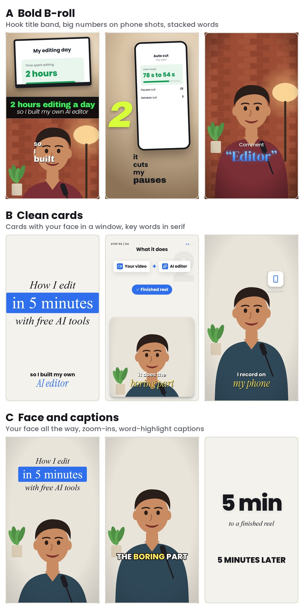
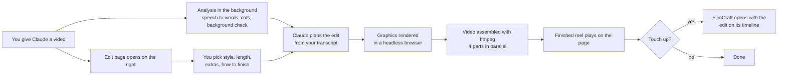
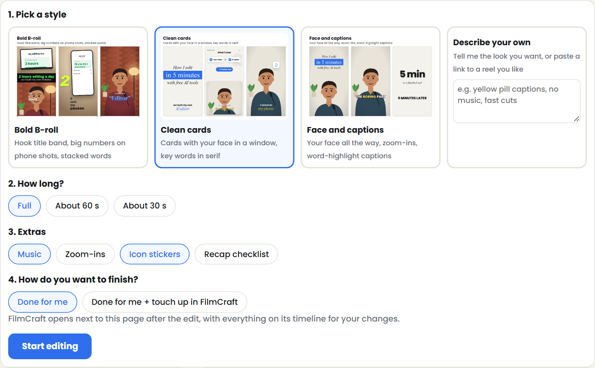
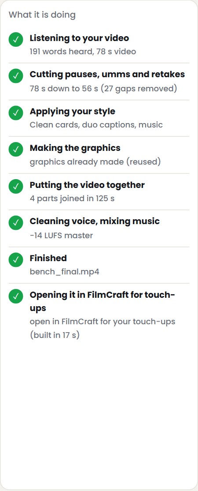
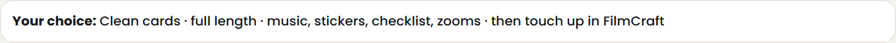
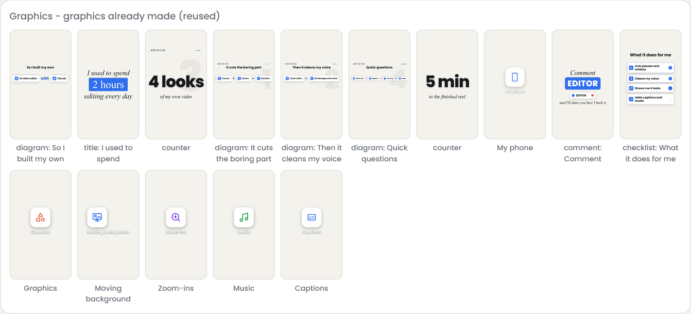

# pro-video-editor

A Claude Code skill that edits talking-head videos into finished reels and YouTube videos. You record on your
phone, give it the file, pick a style on one page, and watch the edit happen. It cuts the pauses, umms and
retakes, cleans your voice, adds captions, graphics, stickers, music and sound effects, grades the colour and
exports a ready-to-post video. If you want to change something by hand, it can open the whole edit in
FilmCraft, a free video editor.

Everything heavy runs on your own computer with free, open-source tools. No API keys, no ChatGPT, no paid
services. Claude Code (your normal Claude plan) is the part that reads your transcript and decides the edit.



## Contents

- [What you get](#what-you-get)
- [How it works](#how-it-works)
- [The edit page](#the-edit-page)
- [Editing styles and looks](#editing-styles-and-looks)
- [Methods: what happens at each step](#methods-what-happens-at-each-step)
- [Speed](#speed)
- [Install](#install)
- [Use](#use)
- [Optional: touch up in FilmCraft](#optional-touch-up-in-filmcraft)
- [Folder map](#folder-map)
- [Privacy, licences and limits](#privacy-licences-and-limits)

## What you get

- Dead air, filler sounds ("umm", "ahh") and retakes cut out automatically, from word timings.
- Clean voice: noise reduction, background-voice gate, EQ, de-esser, compressor, -14 LUFS loudness.
- Three editing styles learned from successful creators in the AI and side-hustle niche, plus "describe your own".
- Captions in five styles (word highlight, serif key words, stacked words, pill, minimal).
- Animated graphics: title cards, step cards, diagrams, counters, checklists, prompt boxes, phone and laptop
  mock-ups, big step numbers, icon stickers (2,437 icons), comment call-to-action, end card.
- Original music in six moods, made for each video, lowered automatically under your voice.
- Sound effects on every visual beat (pops, ticks, whooshes), pre-mixed.
- Green screen swap to a moving background.
- A live page that shows each step while it happens, and an optional hand-editing step in FilmCraft.

## How it works



1. **You give Claude the video** (drag it in, or type `@` and the path). Nothing else is needed.
2. **The edit page opens** in Claude's browser pane, and the analysis starts at the same time, so you never wait
   for the first question.
3. **You choose** on the page: a style from the pictures (or describe your own), the length, extras, and whether
   you want to touch it up in FilmCraft afterwards. Press **Start editing**.
4. **Claude plans the edit** from your transcript: which card goes where, what it says (in your own words, run
   through the humanizer so it never sounds AI-written), which stickers pop up when you name something.
5. **The page shows the work live**: graphics appear as they are made, the render percentage climbs, then the
   finished video plays there.
6. **Optional**: FilmCraft opens with everything on a real timeline for hand changes.

## The edit page

One page for the whole job. It runs on your own computer only (`127.0.0.1`) and opens on the right side of the
Claude app.

**1. Choose.** Style pictures, "describe your own", length, extras and how to finish:



**2. Watch.** Every step with a short note on what it did, then your choice summarised:





**3. See the plan.** A clickable timeline: the parts of your original that were kept (green) and cut (grey),
cards, stickers, captions and music. Click anywhere to jump the video there.


**4. See the graphics.** Each graphic shows up the moment it is rendered:



The page also shows the cut video, then the finished one, and your transcript with the cut words struck out
(click a word to jump there).

## Editing styles and looks

| Style | What it looks like | Best for |
|---|---|---|
| **Bold B-roll** | Hook title band over B-roll, warm cinematic face, a big lime number over a phone or laptop shot for every point, stacked-word captions, glowing "Comment X", end card | Lists and "N steps" videos |
| **Clean cards** | Cards above your face in a rounded window, full-screen cards, serif key-word captions, step headers | Explainers and how-tos |
| **Face and captions** | Your face the whole time, zoom-ins, word-highlight captions, a title and a few cards | Opinions and stories; fastest |
| **Describe your own** | Claude picks the nearest style and applies what you wrote (or studies a reel you link) | Anything else |

Colour looks for Clean cards and Face and captions:


The gallery pictures use an illustrated presenter drawn in code (no real person). They are rebuilt with
`scripts/make_gallery.py` whenever a template changes, so they always match what the skill makes.

## Methods: what happens at each step

**Speech to words** (`scripts/transcribe.py`). faster-whisper "small" (int8) on the CPU gives every word with a
start and end time. A second, word-for-word pass re-listens to stretched words, because Whisper tidies speech
and would otherwise hide repeated words.

**Cutting** (`scripts/cut.py`).
- Pauses: gaps between words, plus ffmpeg `silencedetect` set 2 dB under your average voice level.
- Words are protected: a quiet word is never removed as "silence", and a slowly spoken word keeps at least
  0.4 s (only the dead air inside it is trimmed).
- Fillers: "umm", "uh", stretched "ohhh/ahh/hmm".
- Retakes: a restart within 12 s that matches 60% of the words just said is cut; back-to-back doubles
  ("and and") are always cut; common phrases like "step by step" are kept.

**Analysis** (`scripts/analyze.py`). Picks a starting preset from the video's shape and topic, checks loudness and
noise, and checks the background: a real or digital green screen, or a plain wall far from skin and clothes
colours, can be swapped.

**Face framing** (`scripts/face_frame.py`). A small person-segmentation model (BiRefNet-lite, MIT) finds your head on
three frames while you are choosing, so crops and zoom-ins stay centred on your face.

**Graphics** (`templates/gfx.html`, `scripts/render_gfx.mjs`). Each graphic is an HTML page animated frame by frame in
one headless Chromium (Playwright). Frames that do not change are reused. Full-screen graphics are captured as
JPEG into H.264, transparent ones as PNG into QuickTime Animation. Fonts are Poppins, Instrument Serif,
Archivo Black and DM Serif Display (all OFL); icons are Lucide (ISC).

**Captions** (`scripts/captions.py`). Written as an ASS subtitle file and burned in with libass. Groups never end on
small words like "a" or "the"; on light cards the small words turn dark so they stay readable.

**Assembly** (`scripts/compose.py`). One ffmpeg filter graph per part, four parts rendered at the same time and joined
without re-encoding.
- Crop and colour grade at the source resolution, then one upscale (phone footage is often 576x1024).
- Zoom-ins: the same crop shrinks at the zoom moments (ffmpeg `sendcmd`), so there is no second zoomed copy.
- Layouts: face only, card above a rounded face window on a moving page background, full-screen cards.
- Green screen: a tight colour key for flat digital screens, a chroma key for real ones, then despill and a
  2-pixel edge pull so no green fringe stays on hair.
- Encoding: x264 veryfast, CRF 18.

**Sound** (`scripts/sfx_design.py`, `scripts/music.py`). Sound effects are placed from the plan (a tick per checklist
item, a pop per sticker, a whoosh per card) and mixed into one track. Music is composed by the script in the
chosen mood, levelled, ducked under your voice with a sidechain compressor, and faded. The voice chain is
noise reduction, a speech gate built from the word timings, EQ, de-esser and a compressor. The master is
-14 LUFS with a limiter.

**Live page** (`scripts/live.py`, `scripts/livelog.py`, `templates/live.html`). A small standard-library web server on
127.0.0.1. Each step writes a short note to `live.json`, the page polls it every second, and render progress is
read from ffmpeg's `-progress` files. Your choice is sent back as `choice.json`, protected by a one-time page
token so no other website can post to it.

**FilmCraft bridge** (`scripts/filmcraft_open.py`). Drives FilmCraft through its documented JSON control channel with a
fresh random token kept only in memory: imports the original video and graphics (converted to ProRes 4444
with transparency), places the kept parts, cards, stickers, captions and music, and saves a `.fcproj`.

## Speed

Measured on a 4-core laptop with no NVIDIA graphics card, for a 1-minute phone reel:

| Step | Time |
|---|---|
| Listening and cutting | about 1 min, while you choose your style |
| Graphics | 20 s to 3 min, depending on how many |
| Assembling the video | about 2 min (was 3 min 43 s before the speed work) |
| FilmCraft hand-off (optional) | about 1 min |

How the assembly got 44% faster at the same quality (checked with SSIM against a near-lossless reference):
grading at source resolution (effects 54.6 s to 20.5 s per part), zoom-ins as one timed crop, and x264
veryfast at CRF 18 (SSIM 0.98753 vs 0.98765 for the old setting). Details in
[references/engineering-notes.md](references/engineering-notes.md).

## Install

Windows, with Python 3.10 to 3.12 from python.org, Node.js LTS and ffmpeg:

```powershell
winget install Gyan.FFmpeg
```

```powershell
powershell -ExecutionPolicy Bypass -File install.ps1
```

The first install takes 5 to 10 minutes: it creates a Python environment, installs the headless browser and
downloads the Whisper speech model (about 480 MB) and the person model (224 MB).

| Option | What it adds |
|---|---|
| `-WithFilmCraft` | FilmCraft for hand touch-ups (free, MIT or Apache-2.0, about 115 MB, checksum verified) |
| `-WithRNNoise` | Neural voice noise models (no explicit licence, so opt-in) |
| `-NoModels` | Skips the model downloads |
| `-AllowNonMIT` | Extra libraries that are not MIT or ISC (off by default) |

If Windows Smart App Control briefly blocks a new library, the installer waits and tries again. It never turns
any protection off.

## Use

In Claude Code, from any folder:

- `@"D:\clips\my-reel.mp4"` and nothing else: the edit page opens and you choose there.
- "Edit this into a 30 s reel with yellow captions and no music": the description is used as your style.
- "Swap the green background": works when the background can be keyed.
- "Change the music to cinematic", "make the captions bigger": Claude edits the plan and re-renders.

Command line without Claude (cuts, voice, captions, colour, zoom-ins and music, but no cards or stickers,
because those need judgement):

```powershell
.venv\Scripts\python.exe scripts\autoedit.py "my video.mp4"
```

## Optional: touch up in FilmCraft

Choose **Done for me + touch up in FilmCraft** on the edit page, or press **Open in FilmCraft** after any edit.
FilmCraft opens as its own window with:

| Track | Contents |
|---|---|
| V1 / A1 | your original video in its kept parts, so every cut can be adjusted |
| V2 | page-colour background under full-screen cards |
| V3 | cards |
| V4 | stickers, at the same positions as in the reel |
| C1 | captions |
| A2 | music at the reel's level |

FilmCraft does not reproduce the skill's caption styles or the card-and-face-window layout, so the reel from the
skill stays the final file. FilmCraft is best for trying changes (for example a different music track) by hand.

## Folder map

```
SKILL.md                  instructions Claude follows (the workflow above)
install.ps1               installer
scripts/                  autoedit, transcribe, cut, analyze, compose, captions, render_gfx, live, filmcraft_open,
                          music, sfx_design, make_gallery, learn_style (study a reference reel), and more
templates/                gfx.html (all graphics), live.html (edit page), motionbg.html, title3d.html
styles/                   edit_styles.json (the three styles), presets.json, themes.json (colour looks)
assets/                   fonts, icons, sound effects, gallery pictures
references/               style notes learned from reference videos, engineering notes, recording guide
skills/                   humanizer and YouTube helpers (chapters, titles, SEO, Shorts)
vendor/                   vendored MIT libraries (see LICENSES.md)
docs/img/                 the screenshots in this README
```

## Privacy, licences and limits

- **Your videos stay on your computer.** Only the transcript text and the still frames Claude checks go to Claude,
  as with anything in Claude Code. The live page and FilmCraft listen on 127.0.0.1 only. This repository never
  contains videos, audio or edit folders (see `.gitignore`).
- **Licences:** everything bundled is MIT, ISC or OFL; anything else is opt-in. See [LICENSES.md](LICENSES.md).
- **Limits:**
  - Whisper can mishear names, so Claude checks the transcript.
  - Background voices talking over you cannot be separated.
  - Background swap needs a green or blue screen or a plain wall far from your skin and clothes colours.
  - WhatsApp lowers video quality, so send the original file by cable or Drive.
